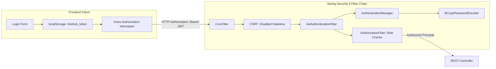
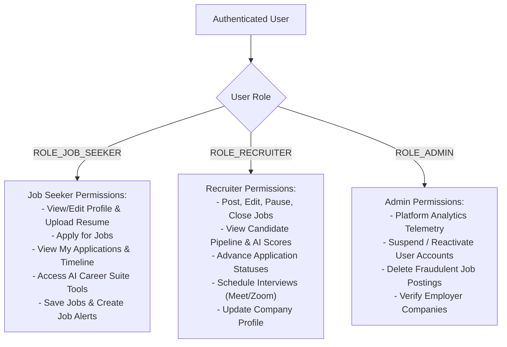

# HireHub — Authentication & Security Architecture

## 1. Security Overview

Security is built into HireHub as a core architectural tier rather than an afterthought. The platform implements **stateless JSON Web Token (JWT) authentication**, **BCrypt password hashing**, **Spring Security 6 role-based authorization**, **CORS origin protection**, and **Jakarta Bean Validation**.



---

## 2. Password Hashing with BCrypt

User passwords are never stored in plaintext. HireHub utilizes Spring Security's `BCryptPasswordEncoder` bean:

- **Algorithm:** BCrypt adaptive one-way cryptographic hash with random 16-byte salt generation.
- **Strength / Work Factor:** Standard 10 rounds of key derivation (resistant to GPU and rainbow-table brute-force attacks).
- **Verification:** `passwordEncoder.matches(rawPassword, encodedPassword)` during authentication.

---

## 3. Stateless JWT Token Architecture

HireHub adheres to OAuth2/OIDC standards using signed JSON Web Tokens for stateless session management:

### 3.1 Token Structure
A HireHub JWT comprises three base64url-encoded parts:
1. **Header:** Algorithm (`HS256`) and Token Type (`JWT`).
2. **Payload Claims:**
   - `sub`: User email address (`seeker@hirehub.com`).
   - `userId`: Numeric primary key (`1`).
   - `role`: System authority (`ROLE_JOB_SEEKER`).
   - `iat`: Issued-at epoch timestamp.
   - `exp`: Expiration timestamp (24 hours for access tokens; 7 days for refresh tokens).
3. **Signature:** Generated using HMAC-SHA256 with a 256-bit secret key.

### 3.2 Configuration (`application.properties`):
```properties
# JWT Configuration
hirehub.jwt.secret=${JWT_SECRET:hirehubSuperSecretKeyForJwtSigningMustBeAtLeast256BitsLongForHS256Algorithm2026Secure}
hirehub.jwt.expiration-ms=86400000          # 24 Hours
hirehub.jwt.refresh-expiration-ms=604800000  # 7 Days
```

---

## 4. Role-Based Access Control (RBAC)

HireHub strictly distinguishes three system roles:



### Backend Enforcement:
Endpoints are guarded via method-level annotations:
```java
@PreAuthorize("hasRole('ADMIN')")
@PreAuthorize("hasAnyRole('RECRUITER', 'ADMIN')")
@PreAuthorize("hasRole('JOB_SEEKER')")
```

---

## 5. Client-Side Route Protection (`ProtectedRoute.jsx`)

On the React frontend, sensitive pages are wrapped with the `<ProtectedRoute>` component:
```jsx
<Route
  path="/recruiter/dashboard"
  element={
    <ProtectedRoute allowedRoles={['ROLE_RECRUITER']}>
      <RecruiterDashboard />
    </ProtectedRoute>
  }
/>
```
- If the user is unauthenticated, they are redirected to `/login`.
- If authenticated under an unauthorized role, they are safely redirected to the root `/` page.

---

## 6. Input Validation & File Upload Security

1. **Bean Validation:** Incoming request bodies are validated using `@Valid` annotations on DTOs:
   - `@NotNull(message = "Job title is required")`
   - `@Size(min = 6, message = "Password must be at least 6 characters")`
   - `@Email(message = "Email must be valid")`
2. **File Upload Hardening:**
   - File size limited to 10MB (`spring.servlet.multipart.max-file-size=10MB`).
   - Resumes validated for PDF and DOC extensions.
   - Uploaded files stored outside web root with randomized unique file names.
