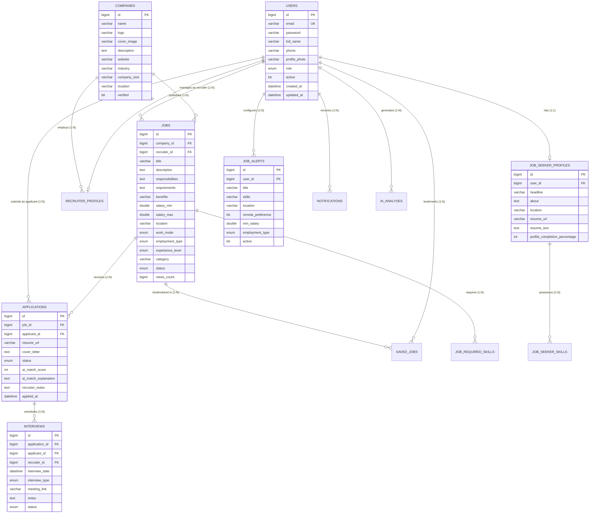

# HireHub — Database Documentation

## 1. Overview

HireHub relies on **MySQL 8.0** for relational persistence. The database schema is managed via Spring Data JPA and Hibernate ORM (`hibernate.ddl-auto=update`), with strict foreign keys, unique constraints, and optimized indexes on frequently filtered columns.

- **Database Name:** `hirehub_db`
- **Total Tables:** 20 verified relational tables
- **Charset / Collation:** `utf8mb4` / `utf8mb4_unicode_ci`

---

## 2. Entity-Relationship (ER) Diagram

---

## 3. Detailed Table Schema Definitions

### 3.1 `users` Table
Stores authentication credentials, user roles, and account status.
| Column | Type | Nullable | Key | Description |
| :--- | :--- | :--- | :--- | :--- |
| `id` | `bigint` | NO | PRIMARY | Auto-increment unique user identifier |
| `email` | `varchar(120)` | NO | UNIQUE | User login email address |
| `password` | `varchar(255)` | NO | | BCrypt encrypted password hash |
| `full_name` | `varchar(100)` | NO | | User's full display name |
| `phone` | `varchar(20)` | YES | | Contact phone number |
| `profile_photo` | `varchar(500)` | YES | | Profile photo URL |
| `role` | `enum('ROLE_ADMIN', 'ROLE_JOB_SEEKER', 'ROLE_RECRUITER')` | NO | INDEX | System access role |
| `active` | `bit(1)` | NO | | Account status (1 = Active, 0 = Suspended) |
| `created_at` | `datetime(6)` | YES | | Account registration timestamp |
| `updated_at` | `datetime(6)` | YES | | Last profile update timestamp |

---

### 3.2 `companies` Table
Stores verified organization metadata and employer branding.
| Column | Type | Nullable | Key | Description |
| :--- | :--- | :--- | :--- | :--- |
| `id` | `bigint` | NO | PRIMARY | Auto-increment unique company ID |
| `name` | `varchar(150)` | NO | INDEX | Registered company name |
| `logo` | `varchar(500)` | YES | | Hosted logo image URL |
| `cover_image` | `varchar(500)` | YES | | Profile cover banner image URL |
| `description` | `text` | YES | | About company and culture |
| `website` | `varchar(200)` | YES | | Official corporate website |
| `industry` | `varchar(100)` | YES | INDEX | Business vertical (Fintech, SaaS, AI) |
| `company_size`| `varchar(50)` | YES | | Headcount range (e.g. `100-500 employees`) |
| `location` | `varchar(150)` | YES | | Headquarters location |
| `verified` | `bit(1)` | NO | | Verification badge status |

---

### 3.3 `jobs` Table
Stores job requisitions posted by recruiters.
| Column | Type | Nullable | Key | Description |
| :--- | :--- | :--- | :--- | :--- |
| `id` | `bigint` | NO | PRIMARY | Auto-increment requisition identifier |
| `company_id` | `bigint` | NO | FK | Foreign key referencing `companies(id)` |
| `recruiter_id`| `bigint` | NO | FK | Foreign key referencing `users(id)` |
| `title` | `varchar(200)` | NO | INDEX | Job requisition title |
| `description` | `text` | NO | | Full job overview |
| `responsibilities` | `text` | YES | | Key role responsibilities |
| `requirements` | `text` | YES | | Required qualifications |
| `benefits` | `varchar(500)` | YES | | Compensation perks and insurance |
| `salary_min` | `double` | YES | | Minimum salary threshold |
| `salary_max` | `double` | YES | | Maximum salary threshold |
| `location` | `varchar(150)` | YES | INDEX | Primary job location |
| `work_mode` | `enum('HYBRID', 'ON_SITE', 'REMOTE')` | NO | INDEX | Work arrangement |
| `employment_type` | `enum('CONTRACT', 'FREELANCE', 'FULL_TIME', 'INTERNSHIP', 'PART_TIME')` | NO | | Employment classification |
| `experience_level` | `enum('ENTRY_LEVEL', 'EXECUTIVE', 'LEAD', 'MID_LEVEL', 'SENIOR_LEVEL')` | NO | | Seniority tier |
| `category` | `varchar(100)` | YES | INDEX | Domain department (Engineering, Product) |
| `status` | `enum('CLOSED', 'DRAFT', 'PAUSED', 'PUBLISHED')` | NO | INDEX | Requisition visibility state |
| `views_count` | `bigint` | YES | | Number of public views |

---

### 3.4 `applications` Table
Tracks candidate submissions and their hiring funnel status.
| Column | Type | Nullable | Key | Description |
| :--- | :--- | :--- | :--- | :--- |
| `id` | `bigint` | NO | PRIMARY | Auto-increment application ID |
| `job_id` | `bigint` | NO | FK | Foreign key referencing `jobs(id)` |
| `applicant_id`| `bigint` | NO | FK | Foreign key referencing `users(id)` |
| `resume_url` | `varchar(500)` | YES | | URL of the attached resume file |
| `cover_letter`| `text` | YES | | Custom candidate cover letter |
| `status` | `enum('APPLIED', 'INTERVIEW', 'REJECTED', 'SELECTED', 'SHORTLISTED', 'UNDER_REVIEW', 'WITHDRAWN')` | NO | INDEX | Funnel stage |
| `ai_match_score`| `int` | YES | | Semantic compatibility score (0–100) |
| `ai_match_explanation` | `text` | YES | | Detailed AI rationale |
| `recruiter_notes` | `text` | YES | | Internal hiring manager notes |
| `applied_at` | `datetime(6)` | YES | | Application submission timestamp |

---

### 3.5 `interviews` Table
Stores scheduled interview rounds between recruiters and applicants.
| Column | Type | Nullable | Key | Description |
| :--- | :--- | :--- | :--- | :--- |
| `id` | `bigint` | NO | PRIMARY | Auto-increment interview ID |
| `application_id` | `bigint` | NO | FK | Foreign key referencing `applications(id)` |
| `applicant_id` | `bigint` | NO | FK | Foreign key referencing `users(id)` |
| `recruiter_id` | `bigint` | NO | FK | Foreign key referencing `users(id)` |
| `interview_date` | `datetime(6)` | NO | | Scheduled date and time |
| `interview_type` | `enum('BEHAVIORAL', 'FINAL_ROUND', 'HR', 'SYSTEM_DESIGN', 'TECHNICAL')` | NO | | Interview format/stage |
| `meeting_link` | `varchar(500)` | YES | | Video conferencing URL (Meet / Zoom) |
| `notes` | `text` | YES | | Preparation guidelines for candidate |
| `status` | `enum('CANCELLED', 'COMPLETED', 'RESCHEDULED', 'SCHEDULED')` | NO | | Interview execution state |

---

### 3.6 Auxiliary & Association Tables

- **`job_seeker_profiles`:** Stores headline, bio, location, parsed resume text, and profile completion percentage (FK: `user_id`).
- **`recruiter_profiles`:** Stores department, designation, and company association (FKs: `user_id`, `company_id`).
- **`job_required_skills`:** `@ElementCollection` table mapping `job_id` to individual skill strings (e.g. `React`, `Java`, `Spring Boot`).
- **`job_seeker_skills`:** `@ElementCollection` table mapping `profile_id` to candidate skills.
- **`job_alerts`:** User alert preferences (`title`, `skills`, `location`, `remote_preference`, `min_salary`, `employment_type`, `active`).
- **`saved_jobs`:** Bookmark join table mapping `user_id` to `job_id`.
- **`notifications`:** User notification alerts (`title`, `message`, `link`, `type`, `is_read`).
- **`ai_analyses`:** History of generated AI analyses (`analysis_type`, `input_summary`, `result_json`, `user_id`).
- **`educations`, `experiences`, `projects`, `certifications`:** Normalized profile sub-tables.
