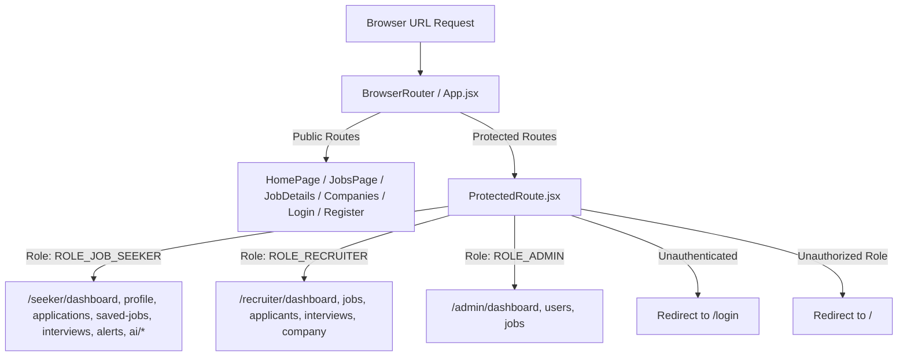

# HireHub — Frontend Documentation

## 1. Overview & Architecture

The **HireHub** frontend is an enterprise single-page application (SPA) built using **React 19** and bundled with **Vite 8.3**. It leverages **Tailwind CSS v4** for styling, **Lucide React** for icons, **Recharts** for analytics, and **React Hot Toast** for notifications.

```
frontend/src/
├── api/
│   └── api.js                   # Axios client with JWT interceptor & API modules
├── assets/                      # Hero graphics, SVGs
├── components/                  # Shared layout & reusable widgets
│   ├── AIChatDrawer.jsx         # Floating interactive career assistant
│   ├── Footer.jsx               # Universal multi-column footer
│   ├── Navbar.jsx               # Navigation bar with 1-click persona switcher
│   └── ProtectedRoute.jsx       # Client-side RBAC route gate
├── context/
│   └── AuthContext.jsx          # User session, JWT tokens, demo login helpers
├── pages/
│   ├── HomePage.jsx             # Public SaaS landing page
│   ├── JobsPage.jsx             # Multi-filter job search & listings
│   ├── JobDetailsPage.jsx       # Job description & real-time AI match modal
│   ├── CompaniesPage.jsx        # Verified employer directory
│   ├── LoginPage.jsx            # Authentication page with demo quick-logins
│   ├── RegisterPage.jsx         # Account creation portal
│   ├── seeker/                  # Job Seeker suite
│   │   ├── SeekerDashboard.jsx  # Main applicant dashboard & stats
│   │   ├── SeekerProfile.jsx    # Profile & resume manager
│   │   ├── ApplicationsPage.jsx # Multi-stage application timeline
│   │   ├── SavedJobsPage.jsx    # Bookmarked opportunities
│   │   ├── InterviewsPage.jsx   # Candidate interview sessions
│   │   ├── JobAlertsPage.jsx    # Automated job alert triggers
│   │   └── ai/                  # AI Career Suite tools
│   │       ├── ResumeAnalyzer.jsx
│   │       ├── CoverLetterGenerator.jsx
│   │       ├── InterviewPrep.jsx
│   │       └── SkillGapAnalyzer.jsx
│   ├── recruiter/               # Recruiter suite
│   │   ├── RecruiterDashboard.jsx
│   │   ├── RecruiterJobsPage.jsx
│   │   ├── ApplicantsPage.jsx
│   │   ├── RecruiterInterviewsPage.jsx
│   │   └── CompanySettingsPage.jsx
│   └── admin/                   # Admin console
│       ├── AdminDashboard.jsx
│       ├── AdminUsersPage.jsx
│       └── AdminJobsPage.jsx
├── App.jsx                      # Client router configuration
└── main.jsx                     # Application bootstrap
```

---

## 2. Client Routing & Role Guards (`App.jsx`)

HireHub configures declarative routes using `react-router-dom`:



### Route Map:
| Route Path | Component | Guard / Access Level |
| :--- | :--- | :--- |
| `/` | `HomePage` | Public |
| `/jobs` | `JobsPage` | Public |
| `/jobs/:id` | `JobDetailsPage` | Public (Apply requires Auth) |
| `/companies` | `CompaniesPage` | Public |
| `/login` | `LoginPage` | Public |
| `/register` | `RegisterPage` | Public |
| `/seeker/dashboard` | `SeekerDashboard` | `ROLE_JOB_SEEKER` |
| `/seeker/profile` | `SeekerProfile` | `ROLE_JOB_SEEKER` |
| `/seeker/applications` | `ApplicationsPage` | `ROLE_JOB_SEEKER` |
| `/seeker/saved-jobs` | `SavedJobsPage` | `ROLE_JOB_SEEKER` |
| `/seeker/interviews` | `InterviewsPage` | `ROLE_JOB_SEEKER` |
| `/seeker/alerts` | `JobAlertsPage` | `ROLE_JOB_SEEKER` |
| `/seeker/ai/resume-analyzer` | `ResumeAnalyzer` | `ROLE_JOB_SEEKER` |
| `/seeker/ai/cover-letter` | `CoverLetterGenerator` | `ROLE_JOB_SEEKER` |
| `/seeker/ai/interview-prep` | `InterviewPrep` | `ROLE_JOB_SEEKER` |
| `/seeker/ai/skill-gap` | `SkillGapAnalyzer` | `ROLE_JOB_SEEKER` |
| `/recruiter/dashboard` | `RecruiterDashboard` | `ROLE_RECRUITER` |
| `/recruiter/jobs` | `RecruiterJobsPage` | `ROLE_RECRUITER` |
| `/recruiter/applicants` | `ApplicantsPage` | `ROLE_RECRUITER` |
| `/recruiter/interviews` | `RecruiterInterviewsPage` | `ROLE_RECRUITER` |
| `/recruiter/company` | `CompanySettingsPage` | `ROLE_RECRUITER` |
| `/admin/dashboard` | `AdminDashboard` | `ROLE_ADMIN` |
| `/admin/users` | `AdminUsersPage` | `ROLE_ADMIN` |
| `/admin/jobs` | `AdminJobsPage` | `ROLE_ADMIN` |

---

## 3. State Management & Authentication (`AuthContext.jsx`)

The authentication state is managed via React Context and persisted in browser `localStorage`:

- **State Variables:**
  - `user`: Object containing `id`, `email`, `fullName`, `role`.
  - `token`: Cryptographically signed JWT token string.
  - `isAuthenticated`: Boolean helper (`Boolean(token && user)`).
  - `loading`: Tracks initial authentication token validation.
- **Methods:**
  - `login(token, user)`: Sets headers, saves to `localStorage`, and updates state.
  - `logout()`: Clears `localStorage`, removes Authorization headers, navigates to `/login`.
  - `switchRoleDemo(targetRole)`: Switches between demo accounts without typing passwords:
    - `ROLE_JOB_SEEKER`: `seeker@hirehub.com` / `password123`
    - `ROLE_RECRUITER`: `recruiter@stripe.com` / `password123`
    - `ROLE_ADMIN`: `admin@hirehub.com` / `password123`

---

## 4. API Client & HTTP Interceptors (`src/api/api.js`)

All communication with the Spring Boot backend is channeled through an Axios singleton instance configured with:

1. **Base URL:** `/api` (proxied to `http://localhost:8080` in `vite.config.js`).
2. **Request Interceptor:** Automatically checks `localStorage` for `hirehub_token` and attaches `Authorization: Bearer <token>` to all outgoing requests.
3. **Response Interceptor:** Intercepts HTTP 401 Unauthorized errors and redirects the user to `/login?expired=true`.
4. **Organized Service Modules:**
   - `authApi`: `login`, `register`, `refreshToken`
   - `jobsApi`: `getJobs`, `getJobById`, `getCategories`, `getRecruiterJobs`, `createJob`, `updateJob`, `updateStatus`, `deleteJob`
   - `companiesApi`: `getCompanies`, `getCompanyById`, `createCompany`, `updateCompany`
   - `applicationsApi`: `apply`, `getMyApplications`, `getJobApplications`, `getRecruiterApplications`, `updateStatus`, `withdraw`
   - `userApi`: `getJobSeekerProfile`, `updateJobSeekerProfile`, `uploadResume`, `getRecruiterProfile`, `saveJob`, `unsaveJob`, `getSavedJobs`, `getAlerts`, `createAlert`, `deleteAlert`
   - `interviewsApi`: `schedule`, `getSeekerInterviews`, `getRecruiterInterviews`, `updateStatus`
   - `aiApi`: `analyzeResume`, `matchJob`, `generateCoverLetter`, `generateInterviewPrep`, `careerChat`, `analyzeSkillGap`
   - `notificationsApi`: `getNotifications`, `getUnreadCount`, `markAsRead`, `markAllAsRead`
   - `adminApi`: `getAnalytics`, `getUsers`, `toggleUserStatus`, `getAllJobs`, `deleteJob`, `verifyCompany`

---

## 5. UI/UX Design System & Theme

HireHub adopts a modern SaaS design language combining principles from **Linear**, **Stripe**, and **Notion**:

- **Color Palette:**
  - Background: Crisp off-white (`bg-slate-50`, `#f8fafc`).
  - Text: Deep navy slate (`text-slate-900`, `#0f172a`) for maximum readability.
  - Accent / Primary: Electric Blue (`bg-blue-600`, `#2563eb`) with Indigo secondary (`#4f46e5`).
  - Success / Alert: Emerald Green (`#10b981`), Amber (`#f59e0b`), Rose (`#f43f5e`).
- **Cards & Surfaces:** Soft rounded cards (`rounded-2xl`), subtle borders (`border-slate-200/90`), and minimal shadows (`shadow-xs` / `shadow-sm`).
- **Interactive States:** Loading skeleton animations, responsive mobile slide-out drawers, and clean empty states.
