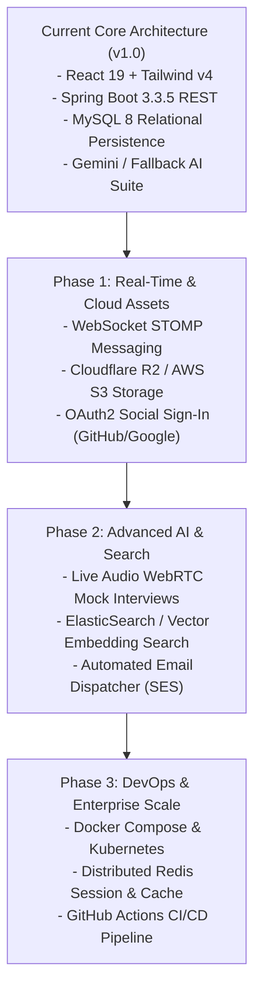

# HireHub — Future Enhancements & Engineering Roadmap

## 1. Overview

While **HireHub** currently provides a robust, production-quality full-stack platform with verified AI resume scoring, candidate pipeline management, and role-based workflows, this document outlines high-value architectural initiatives planned for subsequent release cycles.

---

## 2. Planned Architectural Initiatives



---

## 3. Detailed Future Capabilities

### 3.1 Real-Time WebSocket Communication
- **Current State:** Notification badge polls `/api/notifications/unread-count`.
- **Planned Enhancement:** Implement Spring WebSocket (`spring-boot-starter-websocket`) with STOMP protocol and SockJS fallback.
- **Benefits:** Instant live push notifications when application statuses update, live interview reminders, and real-time chat between recruiters and candidates.

---

### 3.2 Cloud Object Storage Integration (AWS S3 / Cloudflare R2)
- **Current State:** Uploaded candidate resumes are stored in local file directories (`./uploads`).
- **Planned Enhancement:** Migrate binary uploads to Amazon S3 or Cloudflare R2 with time-limited pre-signed URLs.
- **Benefits:** Unlimited media scalability, zero server storage degradation, and enhanced security controls.

---

### 3.3 OAuth2 Social Login Integration
- **Current State:** Email and password authentication with BCrypt hashing and JWT tokens.
- **Planned Enhancement:** Integrate Spring Security OAuth2 Client for one-click **"Sign in with Google"** and **"Sign in with GitHub"**.
- **Benefits:** Lower registration friction and instant verification of developer profiles.

---

### 3.4 Multimodal Audio/Video AI Mock Interview Simulator
- **Current State:** Text-based interview question generation with technical and behavioral model answers.
- **Planned Enhancement:** Utilize WebRTC to capture candidate voice and webcam responses, streaming audio to Gemini 1.5 Pro / Whisper for real-time cadence, clarity, and technical correctness feedback.
- **Benefits:** Immersive real-time interview practice mimicking actual high-stakes technical phone screens.

---

### 3.5 Vector Embeddings & Semantic Semantic Search (pgvector / OpenSearch)
- **Current State:** Relational JPQL multi-filter search with database indexing.
- **Planned Enhancement:** Generate text embeddings for resumes and job postings using `text-embedding-004` and index them in a vector database for semantic match discovery.
- **Benefits:** Enables semantic search queries like *"Find me backend developers experienced with high-load fintech payment rails"* regardless of exact keyword matches.

---

### 3.6 Automated Transactional Email Notifications
- **Current State:** In-app notifications stored in MySQL `notifications` table.
- **Planned Enhancement:** Integrate AWS SES or SendGrid with Thymeleaf HTML email templates.
- **Benefits:** Automated calendar invites (.ics files) for scheduled interviews and weekly digest emails matching candidate Job Alerts.

---

### 3.7 Containerization & Kubernetes Deployment
- **Planned Enhancement:** Provide multi-stage `Dockerfile` definitions for both backend and frontend, unified by `docker-compose.yml`:
  ```yaml
  version: '3.8'
  services:
    mysql:
      image: mysql:8.0
      environment:
        MYSQL_DATABASE: hirehub_db
        MYSQL_ROOT_PASSWORD: root
    backend:
      build: ./backend
      ports:
        - "8080:8080"
    frontend:
      build: ./frontend
      ports:
        - "5173:80"
  ```
