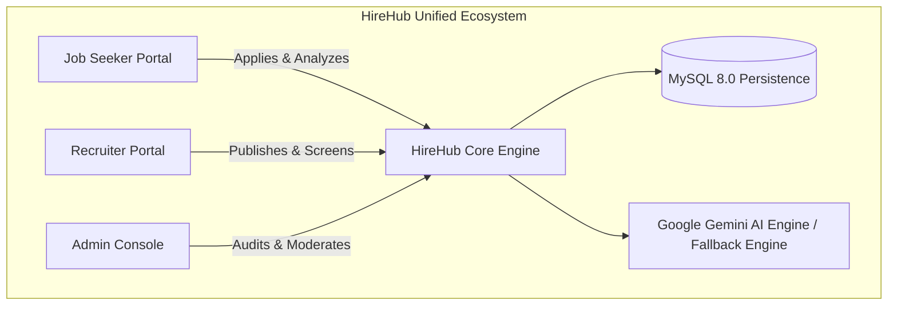
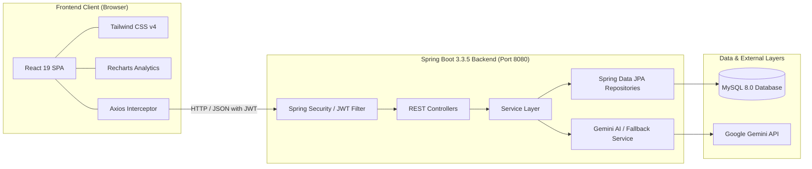

# HireHub — Project Overview

# HIREHUB
### Next-Generation AI-Powered Full-Stack Job Portal
**Tagline:** *"Find your future. Hire your potential."*

---

## 1. Executive Summary & Project Introduction

**HireHub** is an enterprise-grade, full-stack recruitment and talent acquisition platform designed to bridge the gap between ambitious job seekers and forward-thinking engineering recruiters. Built on modern software engineering standards, HireHub unites a reactive **React 19** frontend styled with **Tailwind CSS v4** and a robust, secure **Spring Boot 3.3.5** REST backend backed by **MySQL 8.0** relational persistence.

Unlike conventional job boards that function merely as passive digital bulletin boards, HireHub incorporates an **Artificial Intelligence Career Suite** powered by **Google Gemini API** with deterministic fallback rule heuristics. This intelligent layer enables automatic ATS resume quality scoring, real-time candidate-to-job compatibility analysis, personalized cover letter generation, role-specific interview coaching, and interactive career guidance.

---

## 2. Problem Statement

Modern tech recruitment faces significant frictions on both sides of the hiring equation:

### Challenges for Job Seekers:
1. **The "Resume Black Hole":** Job seekers upload resumes blindly into Applicant Tracking Systems (ATS) without knowing whether their skills match or why they are rejected.
2. **Generic Cover Letters:** Tailoring cover letters to dozens of unique job requisitions is time-consuming and often yields unconvincing, generic documents.
3. **Lack of Transparent Status Tracking:** Candidates rarely receive updates on whether their application is under review, shortlisted, or rejected.
4. **Interview Unpreparedness:** Job seekers lack customized practice questions aligned specifically with the tech stack and behavioral expectations of target roles.

### Challenges for Recruiters & Employers:
1. **Applicant Inundation:** Job postings receive hundreds of unqualified or irrelevant resumes, burdening talent acquisition teams with hours of manual screening.
2. **Fragmented Workflows:** Recruiters juggle disparate tools for job listings, candidate screening, note taking, and interview scheduling.
3. **Subjective Initial Screening:** Screening without standard semantic criteria leads to unconscious bias and missed high-potential talent.

---

## 3. Proposed Solution

HireHub eliminates these inefficiencies through an integrated, three-role ecosystem:

1. **Role-Based Workspaces:** Dedicated dashboards tailored to **Job Seekers**, **Recruiters**, and **System Administrators** with strict JWT role-based access control (`ROLE_JOB_SEEKER`, `ROLE_RECRUITER`, `ROLE_ADMIN`).
2. **AI-Powered Career Intelligence:** Automated ATS evaluation, instant candidate-to-job match scores (0–100%), automated cover letter drafting, interview question generation with sample answers, and career roadmap recommendations.
3. **End-to-End Requisition Lifecycle:** From creating job listings with salary and work mode specifications, to Kanban candidate pipeline management, to scheduling live interview rounds with Google Meet / Zoom integration.
4. **Full Transparency & Moderation:** Real-time application timeline visualization (`APPLIED` → `UNDER_REVIEW` → `SHORTLISTED` → `INTERVIEW` → `SELECTED`), automated notifications, user account moderation, and platform health telemetry.

---

## 4. Project Scope & Target Users

| Target User Group | Primary Needs & Use Cases |
| :--- | :--- |
| **Job Seekers** | Discover engineering roles matching skills; optimize resumes for ATS compatibility; receive real-time match explanations; track multi-stage application statuses; generate personalized cover letters; practice for interviews. |
| **Recruiters & Companies** | Post and manage job requisitions; manage candidate pipelines via Table and Kanban views; review AI match score rankings; schedule and track technical/HR interviews; showcase company culture. |
| **Platform Administrators** | Monitor platform telemetry and user composition; moderate job listings across organizations; activate or suspend user accounts; verify company profiles. |

---

## 5. Main Features Matrix

| Module | Features Included |
| :--- | :--- |
| **Public Portal** | Landing page with real-time title/location search, category exploration chips, featured job cards, verified company showcases, responsive navigation with 1-click persona switcher. |
| **Job Discovery** | Multi-criteria search (title, company, skills, location), filters (Remote / Hybrid / On-site, Full-time / Contract, Salary range, Experience level), relevance and date sorting. |
| **Job Seeker Suite** | Seeker dashboard, profile completion tracker, resume upload with ATS extraction, application status timeline, saved jobs, customizable job alerts with automated matching. |
| **AI Career Suite** | Resume Analyzer (ATS score, detected/missing skills, suggestions), Job Match Score, Cover Letter Generator with tone selection, Interview Prep simulator, Skill Gap Roadmap, floating AI Assistant drawer. |
| **Recruiter Suite** | Recruiter dashboard with hiring funnel conversion charts, job requisition lifecycle (draft, publish, pause, close, delete), candidate pipeline (Table/Kanban), interview coordination. |
| **Admin Console** | Platform analytics dashboard (user breakdown, application funnel), user management (suspend/reactivate accounts), requisition moderation (takedown inappropriate listings). |
| **Security & Auth** | Stateless JWT authentication, BCrypt password hashing, Spring Security role authorization, input validation with Bean Validation, CORS security filters. |

---

## 6. High-Level System Architecture

---

## 7. System Requirements

### Hardware Requirements:
- **Processor:** 64-bit multi-core CPU (Intel Core i5 / AMD Ryzen 5 or higher recommended).
- **RAM:** Minimum 8 GB (16 GB recommended for concurrent Spring Boot and Vite execution).
- **Disk Space:** 2 GB free disk space for runtime dependencies, MySQL database, and logs.

### Software & Runtime Environment:
- **Operating System:** Windows 10/11, macOS, or Ubuntu Linux 20.04+.
- **Java Runtime:** Eclipse Temurin OpenJDK 21 LTS (or compatible Java 21 JDK).
- **Build Tool:** Apache Maven 3.9.x.
- **Node.js Environment:** Node.js v20+ LTS (verified on v26.13.1 LTS) and npm 10+.
- **Database Server:** MySQL Server 8.0+ running on port 3306.
- **Web Browser:** Modern browser (Chrome 110+, Edge 110+, Firefox 110+, Safari 16+).
