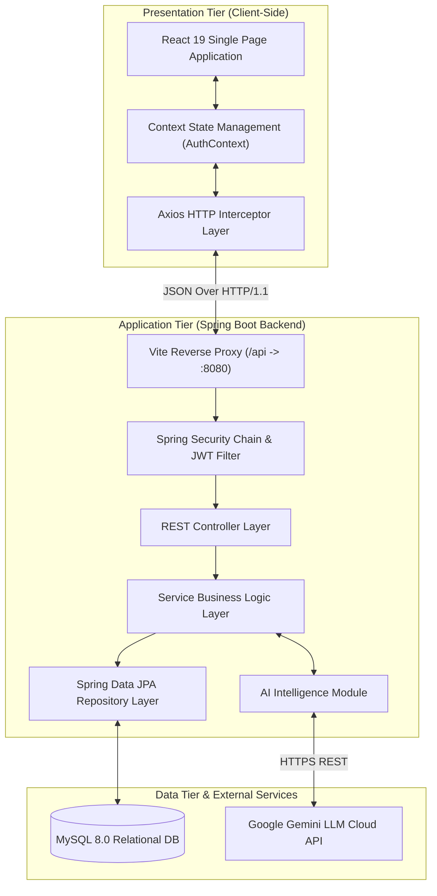
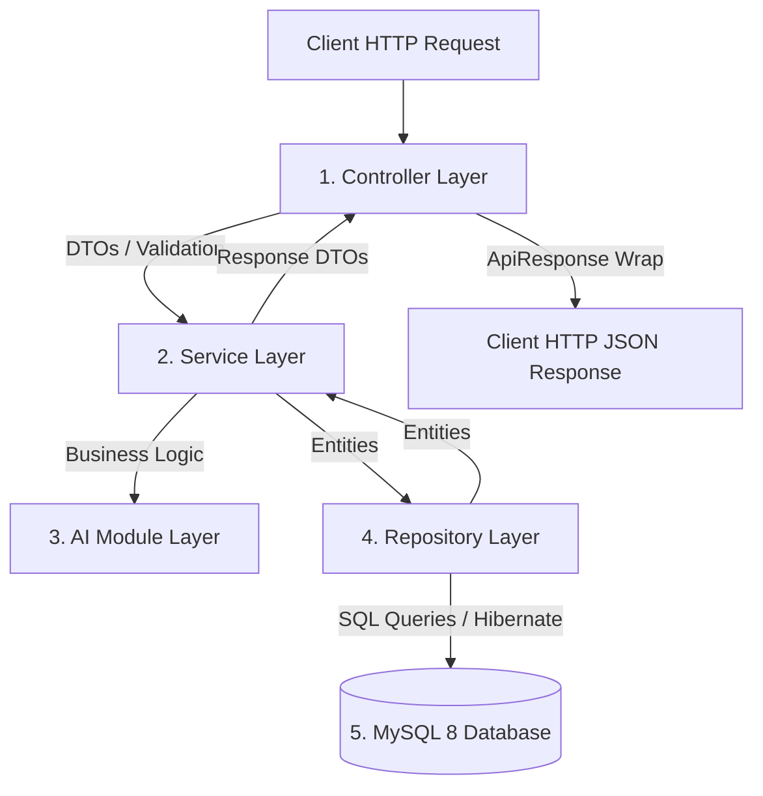
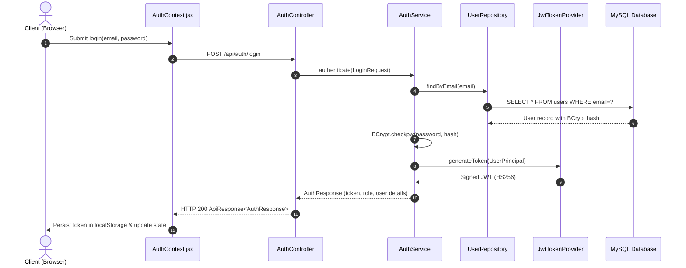
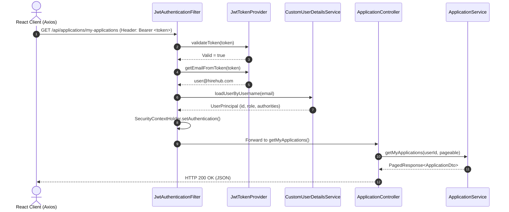
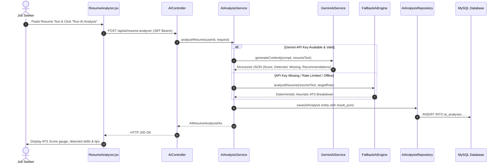
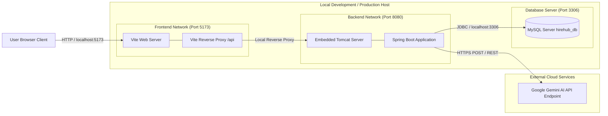

# HireHub — System Architecture Documentation

## 1. Architectural Overview

**HireHub** is designed following the **Client-Server 3-Tier Layered Architecture** with decoupled presentation, application logic, and persistence layers. This modular design ensures separation of concerns, high testability, and horizontal scalability.



---

## 2. Layered Backend Architecture

The Spring Boot backend (`com.hirehub.jobportal`) strictly enforces a 5-layer separation:



### Layer Responsibilities:
1. **Controller Layer (`controller`):** Exposes RESTful endpoints, handles HTTP parameter binding, validates inputs using `@Valid`, and delegates business operations to services. All responses are standardized using `ApiResponse<T>` or `PagedResponse<T>`.
2. **Service Layer (`service`, `service.impl`):** Contains core business logic, transactional boundary management (`@Transactional`), permission checks, entity life-cycle coordination, and event triggers (e.g. notifications).
3. **AI Module (`ai`):** Abstracts LLM integration. Features `GeminiAiService` for cloud inference and `FallbackAiEngine` for offline deterministic scoring and parsing.
4. **Repository Layer (`repository`):** Extends `JpaRepository<T, ID>`, providing declarative CRUD, pagination (`Pageable`), and custom JPQL/native queries.
5. **Entity Layer (`entity`):** Models MySQL database tables via JPA annotations (`@Entity`, `@Table`, `@OneToMany`, `@ManyToOne`, `@Enumerated`).

---

## 3. End-to-End Execution Flows

### 3.1 Authentication & Authorization Flow


### 3.2 Secure API Request Flow with JWT Interceptor


### 3.3 AI Resume Analysis Flow (Resilient Hybrid Pipeline)


---

## 4. Network & Deployment Topology



---

## 5. Error Handling & Resilience Architecture

HireHub implements a centralized exception handling architecture utilizing Spring's `@RestControllerAdvice`:

1. **`GlobalExceptionHandler`:** Intercepts runtime exceptions globally across all controllers.
2. **`ResourceNotFoundException`:** Returns HTTP 404 with standard JSON payload:
   ```json
   {
     "success": false,
     "message": "Job not found with id : 99",
     "data": null,
     "timestamp": "2026-11-25T16:00:00"
   }
   ```
3. **`BadRequestException`:** Returns HTTP 400 for business logic rule violations.
4. **`UnauthorizedException`:** Returns HTTP 401 for invalid credentials or expired JWT tokens.
5. **Bean Validation Handler:** Catches `MethodArgumentNotValidException` and returns a field-level error dictionary (e.g. `{"email": "Email must be valid", "title": "Job title is required"}`).
